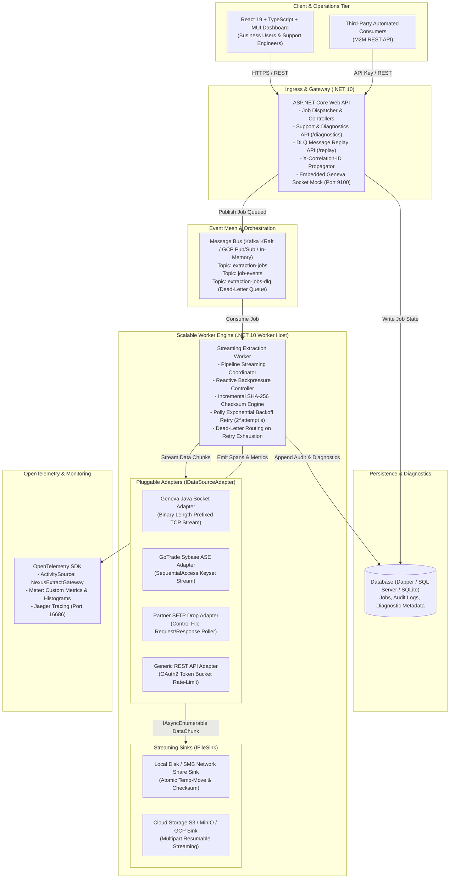

# NexusExtract Gateway (Phases 1, 2 & 3 Completed)
### Enterprise Multi-Source Data Ingestion, Streaming FileSync, Observability & Gemini AI Schema Mapping Platform

Built with **C# / .NET 10**, **React 19 + TypeScript**, **Google Gemini 2.5 + RAG Schema Assistant**, **OpenTelemetry Distributed Tracing & Metrics**, **Apache Kafka & GCP Pub/Sub**, **Dapper + SQL Server**, **S3 / GCP Cloud Storage Streaming Sinks**, **Dead-Letter Queue (DLQ) & Message Replay**, **Terraform IaC**, and **Bitbucket Pipelines CI/CD**.

---

## 1. System Architecture Overview



---

## 2. Key Architectural Pillars (Interview Discussion Guide)

### Pillar 1: Extensible & Pluggable Adapter Engine (Open-Closed Principle)
* **The Problem:** Legacy architectures hardcode extraction logic in monoliths with sprawling `if/else` or `switch` blocks. Adding a new source requires editing core pipeline code.
* **Our Solution:** The `IDataSourceAdapter` interface decouples the extraction engine entirely:
  ```csharp
  public interface IDataSourceAdapter
  {
      SourceType SupportedType { get; }
      Task<ConnectionHealthResult> TestConnectionAsync(string configJson, CancellationToken ct);
      IAsyncEnumerable<DataChunk> ExtractStreamAsync(ExtractionJob job, CancellationToken ct);
  }
  ```
  New sources (e.g. Snowflake, FIX protocol, Mainframe MQ) simply implement `IDataSourceAdapter` and self-register via DI into `IDataSourceAdapterFactory`. Zero changes to existing workers or gateways.

### Pillar 2: Streaming Big Data (Hundreds of GBs) with Zero RAM Accumulation
* **The Problem:** Extracting 100+ GB of trade blotters or portfolio holdings will cause Out-Of-Memory (OOM) crashes if loaded into memory or buffered as full files in RAM.
* **Our Solution:** A completely reactive streaming pipeline using `IAsyncEnumerable<DataChunk>`:
  1. Source adapter streams chunks (64 KB – 5 MB) directly from the underlying network socket or database cursor (`SequentialAccess`).
  2. Data flows through an `IncrementalHash` (SHA-256) calculator on the fly without intermediate disk swapping.
  3. Destination sink streams directly to local disk/SMB share or S3/GCP Cloud Storage multipart upload.
  4. Memory consumption remains strictly bounded under **< 150 MB RAM** regardless of whether the dataset is 10 MB or 500 GB.

### Pillar 3: Self-Service Troubleshooting & Third-Party Diagnostics API
* **The Problem:** When an extract fails, business users and external systems don't know why, creating endless support tickets for developers.
* **Our Solution:**
  1. Every job receives an end-to-end `CorrelationId` and `TraceId` propagated across the frontend, API, Kafka, worker, source socket, and sink.
  2. The `DiagnosticService` inspects error codes, exceptions, and audit logs to categorize root causes:
     * `DatabaseConcurrency`: Detects Sybase lock deadlock (Error 1205) $\rightarrow$ *Remediation: Safe to retry immediately.*
     * `Authentication`: Detects HTTP 401 / expired token $\rightarrow$ *Remediation: Verify credentials in partner portal. No dev needed.*
     * `SourceProtocolError`: Detects Geneva TCP connection refused / socket reset $\rightarrow$ *Remediation: Verify Geneva TCP listener on host/port.*
     * `PartnerSftpTimeout`: Detects SLA breach on response file $\rightarrow$ *Remediation: Contact partner operations.*
  3. External consumers can invoke `GET /api/v1/extractions/jobs/{id}/diagnostics` to receive machine-readable remediation without filing a dev ticket.

### Pillar 4: Hybrid Dual-Engine Execution (Local Demo & Cloud Ready)
* **Docker / Cloud Mode:** Uses SQL Server 2022, Apache Kafka (KRaft), and MinIO S3 Object Storage (`docker compose up`).
* **Standalone In-Process Mode:** Automatically falls back to high-throughput In-Memory Channel Message Bus, SQLite Dapper storage, and an embedded Geneva TCP socket server on port 9100. Any interviewer can review and run the system without prerequisites.

---

## 3. Deep-Dive on the 4 Data Sources

| Source System | Protocol / Transport | Implementation Strategy | Handling Edge Cases |
| :--- | :--- | :--- | :--- |
| **Geneva Java Sockets** | Raw TCP Socket (`127.0.0.1:9100`) | Length-prefixed binary frames: `[4-byte BigEndian length][JSON/CSV payload]`. Reads frames via `NetworkStream` and streams records until length 0 EOS frame. | Polly reconnection policy, socket keep-alive, read timeout watchdog. |
| **GoTrade Sybase ASE** | Relational Database (ADO.NET / SQL) | Streams rows row-by-row via `ExecuteReaderAsync` with `CommandBehavior.SequentialAccess`. Emits streaming CSV chunks every 5,000 records. | Deadlock 1205 detection, lock escalation handling, keyset paging. |
| **Partner SFTP Drop** | SFTP File Protocol (`port 2222`) | Generates request manifest `REQ_<jobId>.ctl`, drops it to `/inbound`, polls `/outbound` for `RESP_<jobId>.csv`, and streams with chunked transfer. | Configurable SLA polling timeout, SHA-256 file validation. |
| **Generic REST API** | HTTPS / REST | Token bucket rate limiting, API Key or OAuth2 bearer token authentication, cursor/page-based paging. | 429 Too Many Requests backoff, 401 token refresh retry. |

---

## 4. How This Project Maps to Your Target Interviews

### For Ingram Micro (Lead Full Stack / Architect):
* **.NET 10 & C#:** Clean architecture, record types, System.IO.Pipelines, dependency injection, and generic background workers.
* **React 19 & TypeScript:** Strict typing, TanStack Query auto-refetching, Zustand state management, and Material UI v6.
* **SQL Optimization & Dapper:** Shows when to use Dapper over EF Core for raw performance, zero overhead, and bulk streaming audit logs.
* **Kafka & Cloud Messaging:** Decoupled event-driven architecture using Kafka producer/consumer with header correlation injection.
* **GCP Cloud Storage & S3:** Pluggable file sync engine supporting Google Cloud Storage and S3 multipart resumable uploads.

### For Medpace (Lead / Senior Engineer):
* **Quality & Data Validation:** Incremental SHA-256 checksums verified upon completion to ensure 100% data integrity for regulated environments.
* **Auditability & Traceability:** Every execution step (Queued $\rightarrow$ Connecting $\rightarrow$ Extracting $\rightarrow$ StreamingToSink $\rightarrow$ Completed) is logged with timestamps, stages, and transferred byte counts.
* **Supportability:** Self-service diagnostic console ensures Level 1 support staff resolve client issues without escalating to engineering.

---

## 5. Quickstart & Running the Application

### Option A: Instant Local Run (Recommended for Demos)
Run the PowerShell launcher script from the repository root:
```powershell
.\run-local.ps1
```
This automatically:
1. Starts the **ASP.NET Core Web API** on `http://localhost:5000` (with Swagger UI at `http://localhost:5000/swagger`).
2. Starts the **Geneva Mock TCP Socket Listener** on `127.0.0.1:9100`.
3. Starts the **React 19 Executive UI** on `http://localhost:5173`.

### Option B: Docker Compose Infrastructure (SQL Server, Kafka KRaft, MinIO, SFTP, Jaeger)
Run all enterprise infrastructure services in Docker:
```powershell
docker compose up -d
```
Services available:
* **SQL Server 2022:** `localhost:1433` (sa / `YourStrong@Passw0rd2026!`)
* **Apache Kafka (KRaft mode):** `localhost:9092`
* **MinIO S3 / Cloud Storage:** `localhost:9000` (Console UI at `http://localhost:9001`)
* **Partner SFTP Server:** `localhost:2222` (`partner_svc` / `SecuredPassword!`)
* **Jaeger OpenTelemetry Tracing UI:** `http://localhost:16686`

### Option C: Terraform Cloud Provisioning (GCP)
```powershell
cd terraform
terraform init
terraform plan
terraform apply
```

### Option D: Running Automated Tests
```powershell
dotnet test tests/NexusExtract.UnitTests/NexusExtract.UnitTests.csproj
```

---

## 6. Phase 3: Gemini AI Schema Mapping Assistant (Completed)
* **Google Gemini 2.5 Structured Outputs:** Native JSON schema constraints guaranteeing typed mapping outputs.
* **Enterprise RAG Knowledge Base:** Grounded in internal product & financial canonical specifications (`v4.2`) and historical supplier synonym mappings.
* **Confidence Scoring & Rationale:** Every field match includes confidence score ($0.0 - 1.0$), transformation rules (`ParseCurrency`, `Trim`, `ToInteger`), and evidence explanations.
* **Human-in-the-Loop (HITL) Governance:** Interactive React 19 UI with operator override dropdowns and one-click canonical commitment.
* **AI Observability & Cost Accounting:** Tracks prompt/completion tokens, latency, and real-time USD costs per inference session.
* **100% Offline Demo Resilience:** Intelligent semantic fallback engine ensures the assistant runs seamlessly without an external API key or network access.

---

## 7. Architecture & Interview Guides
* 📖 [**`docs/ENTERPRISE_ARCHITECT_AND_LEAD_INTERVIEW_ENCYCLOPEDIA.md`**](docs/ENTERPRISE_ARCHITECT_AND_LEAD_INTERVIEW_ENCYCLOPEDIA.md) — **Master Technical Encyclopedia**: Daily revision guide covering C#/.NET 10 CLR internals, React 19 Fiber architecture, SQL optimization, Kafka/PubSub/IBM MQ, GCP Cloud Run, Terraform IaC, OpenTelemetry, Gemini AI & RAG, system design patterns, paid vs open-source tools directory, and STAR behavioral scenarios.
* [`docs/ARCHITECTURE_AND_INTERVIEW_GUIDE.md`](docs/ARCHITECTURE_AND_INTERVIEW_GUIDE.md) — Comprehensive technical architecture handbook & interview talking points.
* [`docs/PHASE_2_ENTERPRISE_CLOUD_AND_OBSERVABILITY.md`](docs/PHASE_2_ENTERPRISE_CLOUD_AND_OBSERVABILITY.md) — Deep-dive on OpenTelemetry, DLQ, Terraform IaC, and CI/CD pipelines.
* [`docs/PHASE_3_AI_SCHEMA_MAPPING_ASSISTANT.md`](docs/PHASE_3_AI_SCHEMA_MAPPING_ASSISTANT.md) — Deep-dive on Google Gemini 2.5, RAG grounding, and Human-in-the-Loop workflows.
