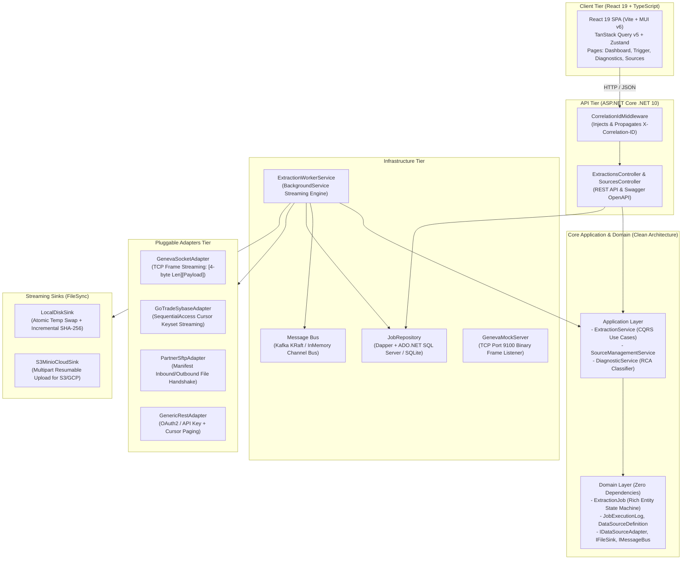

# NexusExtract Gateway | Enterprise Architecture & Technical Interview Guide

## Executive Summary
**NexusExtract Gateway** is an enterprise-grade, high-throughput, pluggable data extraction and streaming file sync platform designed for modern capital markets and B2B data integration. It unifies legacy protocols (Geneva Java TCP sockets, GoTrade Sybase ASE database) and modern integrations (partner SFTP request-response file drops, authenticated REST APIs) behind a clean, reactive streaming pipeline capable of transferring hundreds of gigabytes of data with bounded memory consumption (< 150 MB RAM).

---

## 1. System Architecture Overview



---

## 2. Key Architectural Pillars

### Pillar 1: Extensible & Pluggable Adapter Engine (Open-Closed Principle)
* **Problem:** Traditional enterprise data extractors hardcode data source logic in monoliths with sprawling `switch` statements. Adding new sources requires altering and risking core worker stability.
* **Solution:** The `IDataSourceAdapter` interface decouples source systems completely:
  ```csharp
  public interface IDataSourceAdapter
  {
      SourceType SupportedType { get; }
      Task<ConnectionHealthResult> TestConnectionAsync(string configJson, CancellationToken ct);
      IAsyncEnumerable<DataChunk> ExtractStreamAsync(ExtractionJob job, CancellationToken ct);
  }
  ```
  Adding a new source (e.g., Snowflake, FIX Protocol, Mainframe MQ) only requires implementing `IDataSourceAdapter` and registering it into Dependency Injection. The core worker, API, and message bus require **zero modifications**.

### Pillar 2: Streaming Big Data (Hundreds of GBs) with Zero RAM Accumulation
* **Problem:** Loading 100+ GB of trade blotters or portfolio holdings into memory or buffer tables causes Out-Of-Memory (OOM) failures and huge GC latency pauses.
* **Solution:** Reactive pipeline using `IAsyncEnumerable<DataChunk>`:
  1. Source adapter streams chunks (64 KB – 5 MB) directly from the underlying network socket or database cursor (`SequentialAccess`).
  2. Data flows through an `IncrementalHash` (SHA-256) calculator on the fly without intermediate disk swapping.
  3. Destination sink streams directly to local disk/SMB share or S3/GCP Cloud Storage multipart upload.
  4. Memory consumption remains strictly bounded under **< 150 MB RAM** regardless of whether the dataset is 10 MB or 500 GB.

### Pillar 3: Self-Service Troubleshooting & Third-Party Diagnostics API
* **Problem:** When an extraction fails, business users and external systems don't know why, creating repetitive support tickets for developers.
* **Solution:**
  1. Every job receives an end-to-end `CorrelationId` and `TraceId` propagated across the frontend, API, Kafka, worker, source socket, and sink.
  2. The `DiagnosticService` inspects error codes, exceptions, and audit logs to categorize root causes:
     * `DatabaseConcurrency`: Catches Sybase error 1205 (deadlock) $\rightarrow$ *Remediation: Safe to retry immediately.*
     * `Authentication`: Catches HTTP 401 / expired token $\rightarrow$ *Remediation: Verify credentials in partner portal. No dev needed.*
     * `SourceProtocolError`: Catches Geneva TCP connection refused / socket reset $\rightarrow$ *Remediation: Verify Geneva TCP listener on host/port.*
     * `PartnerSftpTimeout`: Catches SLA timeout $\rightarrow$ *Remediation: Contact partner operations.*
     * `StorageSinkError`: S3/GCS 403 access denied.
     * `DataIntegrityError`: SHA-256 hash mismatch.
  3. External consumers can invoke `GET /api/v1/extractions/jobs/{id}/diagnostics` to receive machine-readable remediation without filing a dev ticket.

### Pillar 4: Hybrid Dual-Engine Execution (Local Demo & Cloud Ready)
* **Docker / Cloud Mode:** Uses SQL Server 2022, Apache Kafka (KRaft), and MinIO S3 Object Storage (`docker compose up`).
* **Standalone In-Process Mode:** Automatically falls back to high-throughput In-Memory Channel Message Bus, SQLite Dapper storage, and an embedded Geneva TCP socket server on port 9100. Any interviewer can review and run the system without prerequisites.

---

## 3. Deep-Dive on Data Source Implementations

| Source System | Protocol / Transport | Implementation Strategy | Handling Edge Cases |
| :--- | :--- | :--- | :--- |
| **Geneva Java Sockets** | Raw TCP Socket (`127.0.0.1:9100`) | Length-prefixed binary frames: `[4-byte BigEndian length][JSON/CSV payload]`. Reads frames via `NetworkStream` and streams records until length 0 EOS frame. | Polly reconnection policy, socket keep-alive, read timeout watchdog. |
| **GoTrade Sybase ASE** | Relational Database (ADO.NET / SQL) | Streams rows row-by-row via `ExecuteReaderAsync` with `CommandBehavior.SequentialAccess`. Emits streaming CSV chunks every 5,000 records. | Deadlock 1205 detection, lock escalation handling, keyset paging. |
| **Partner SFTP Drop** | SFTP File Protocol (`port 2222`) | Generates request manifest `REQ_<jobId>.ctl`, drops it to `/inbound`, polls `/outbound` for `RESP_<jobId>.csv`, and streams with chunked transfer. | Configurable SLA polling timeout, SHA-256 file validation. |
| **Generic REST API** | HTTPS / REST | Token bucket rate limiting, API Key or OAuth2 bearer token authentication, cursor/page-based paging. | 429 Too Many Requests backoff, 401 token refresh retry. |

---

## 4. End-to-End Execution Flows

### Flow 1: Happy Path Extraction (Geneva Java Sockets $\rightarrow$ Local / S3 Sink)
1. **User / 3rd Party:** Calls `POST /api/v1/extractions/jobs`.
2. **API Middleware:** Validates or injects `X-Correlation-ID`.
3. **ExtractionService:** Inserts `ExtractionJob` into DB with status `Queued`, publishes message to Kafka topic `extraction-jobs`, and returns `202 Accepted`.
4. **ExtractionWorkerService:** Consumes message from Kafka, begins logging scope with `JobId` and `CorrelationId`.
5. **GenevaSocketAdapter:** Opens TCP connection to `127.0.0.1:9100`, writes length header + JSON handshake, and starts yielding `DataChunk` objects.
6. **LocalDiskSink / S3MinioCloudSink:** Writes chunks directly to disk/S3 multipart, feeding bytes to `IncrementalHash(SHA256)` on the fly.
7. **Progress Throttler:** Updates DB progress at most every 2 seconds or 5 MB to prevent database lock contention.
8. **Finalization:** Renames `.tmp` file to `.csv`, commits S3 multipart, stores exact SHA-256 hash in DB, marks job `Completed`, and publishes completion event.

### Flow 2: Failure & Self-Service Support Troubleshooting Flow
1. **Worker:** Catches transient exception (e.g., Sybase deadlock error 1205).
2. **Worker:** Marks job `Failed`, persists full exception message and stack trace to DB, and appends a `JobExecutionLog` entry.
3. **Support Engineer:** Receives alert, opens the **Support & Diagnostics Console**, enters the Job ID or Correlation ID.
4. **Diagnostics API:** Calls `GET /api/v1/extractions/jobs/{id}/diagnostics`.
5. **DiagnosticService:** Analyzes logs and classifies the error as `DatabaseConcurrency` $\rightarrow$ Suggested Remediation: *"Safe to retry extraction job."*
6. **Support Engineer:** Reads the clear remediation advice and clicks **Retry / Replay** without needing developer escalation.

---

## 5. Key Design Patterns & Architectural Concepts

| Pattern | Where Used | Purpose |
| :--- | :--- | :--- |
| **Adapter Pattern** | Source Adapters (`Geneva`, `Sybase`, `SFTP`, `REST`) | Normalizes heterogeneous protocols into standard `IDataSourceAdapter`. |
| **Factory Pattern** | `DataSourceAdapterFactory`, `FileSinkFactory` | Resolves concrete adapters dynamically based on enum. |
| **Reactive Streaming Pipeline** | `IAsyncEnumerable<DataChunk>` across pipeline | Ensures streaming without buffering entire files in RAM. |
| **Open-Closed Principle (OCP)** | DI registration in `DependencyInjection.cs` | System is closed for modification, open for new sources. |
| **Result Pattern** | `Result<T>` in Application layer | Functional error handling without throwing costly exceptions. |
| **Correlation Context Pattern** | `CorrelationIdMiddleware` & Kafka Headers | Distributed tracing across UI, API, Kafka, Worker, and Logs. |
| **Incremental Hashing** | `IncrementalHash.CreateHash(SHA256)` | Computes hash in-flight during streaming with zero second-pass overhead. |
| **Atomic File Replacement** | `.tmp` file move in `LocalDiskSink` | Prevents downstream readers from picking up partially written files. |

---

## 6. Interview Talking Points (Ingram Micro & Medpace)

### Q1: "How does your system handle extracting hundreds of gigabytes of data without running out of memory?"
> *"We built an end-to-end reactive streaming pipeline using C#'s `IAsyncEnumerable<DataChunk>`. For database extracts like GoTrade Sybase, we configure the ADO.NET `DbDataReader` with `CommandBehavior.SequentialAccess`, which streams column bytes directly from the network buffer rather than buffering table rows in memory. For sockets like Geneva, we read length-prefixed frames in 64 KB–1 MB chunks. These chunks are immediately piped to the destination sink—either local disk via buffered streams or S3 via multipart uploads—while simultaneously passing the bytes into an in-memory `IncrementalHash` for SHA-256 calculation. Because data is never buffered as a whole, memory utilization stays flat at under 150 MB regardless of file size."*

### Q2: "How did you design the system so that new data sources can be added easily in the future?"
> *"We applied the Open-Closed Principle using the Adapter and Factory patterns. The core worker engine only depends on the `IDataSourceAdapter` interface, which exposes two methods: `TestConnectionAsync` and `ExtractStreamAsync`. Each source—whether a TCP socket, a relational database, an SFTP file-drop, or an OAuth2 REST API—encapsulates its own protocol and configuration parsing. The DI container injects all registered adapters into `DataSourceAdapterFactory`. Adding a 5th source, like Snowflake or Kafka, requires writing one new adapter class and registering it in DI; zero lines in the core worker, API, or message dispatcher need to be changed."*

### Q3: "How do you empower Level 1 support to troubleshoot without escalating to developers?"
> *"Every extraction job receives an end-to-end Correlation ID propagated across the frontend, REST API, Kafka message headers, and database audit logs. We implemented a dedicated `DiagnosticService` that acts as an automated triage engine. It parses error codes and logs against known failure signatures: Sybase error 1205 is classified as `DatabaseConcurrency` with advice that it's safe to retry; HTTP 401 is classified as `Authentication` pointing to expired credentials; and Geneva socket resets are flagged as `SourceProtocolError`. Support engineers use the Diagnostics Console to enter the Job ID or Correlation ID, immediately see the classified root cause, actionable remediation advice, and the exact step where it failed—allowing them to resolve the issue without involving engineering."*

### Q4: "Why did you choose Dapper over EF Core for certain parts of this architecture?"
> *"We used Dapper for the high-throughput read models, telemetry, and audit logging. During large streaming extracts, the worker emits progress logs and status checkpoints. Entity Framework Core introduces change-tracking overhead, entity state snapshotting, and heavier query translation. Dapper executes raw, parameterized ADO.NET queries directly, maximizing throughput and minimizing garbage collection pressure. This demonstrates an intentional architectural trade-off: use the right data access tool for the specific performance requirement."*

---

## 7. Phase 2 Enterprise Cloud Architecture

```mermaid
graph LR
    subgraph CLOUD_RUN ["GCP Cloud Run (Serverless Workloads)"]
        API["NexusExtract.Api\n(Ingress: All, Port 8080)"]
        WORKER["NexusExtract.Worker\n(Internal Workload, Autoscaling 1-20)"]
    end

    subgraph MESSAGING ["GCP Pub/Sub Event Mesh"]
        TOPIC["Topic: extraction-jobs"]
        SUB["Subscription: nexus-worker-sub\n(Max Delivery Attempts: 3)"]
        DLQ["Dead-Letter Topic: extraction-jobs-dlq\n(Retention: 14 Days)"]
    end

    subgraph STORAGE ["Storage & Persistence"]
        SQL["Cloud SQL Server 2022\n(HA, SSD, Deadlock Trace Flag 1204)"]
        GCS["Cloud Storage Datalake\n(Lifecycle: Standard -> Nearline -> Archive)"]
        SECRETS["Google Secret Manager\n(Database Connection Strings & Keys)"]
    end

    subgraph OBSERVABILITY ["OpenTelemetry & Monitoring"]
        OTEL["OpenTelemetry SDK\n- ActivitySource: NexusExtractGateway\n- Meter: Custom Metrics & Histograms"]
        TRACE["Cloud Trace & Jaeger\n(End-to-End Distributed Latency Waterfalls)"]
        METRICS["Cloud Monitoring / Grafana\n(Bytes/Sec, Active Jobs, DLQ Counters)"]
    end

    API -->|Publish Job| TOPIC
    TOPIC --> SUB
    SUB -->|Deliver Message| WORKER
    SUB -.->|Exhausted Retries (3x)| DLQ
    WORKER -->|Stream Data| GCS
    WORKER -->|Persist Status & Logs| SQL
    API -->|Read & Update Jobs| SQL
    API -->|Fetch Secrets| SECRETS
    WORKER -->|Emit Traces & Metrics| OTEL
    OTEL --> TRACE
    OTEL --> METRICS
```

### 7.1 OpenTelemetry Distributed Tracing & Custom Metrics
The application uses the official .NET `System.Diagnostics.ActivitySource` and `System.Diagnostics.Metrics.Meter` for standards-compliant, vendor-neutral observability:
* **`ActivitySource` (`"NexusExtractGateway"`):**
  * Spans created for every stage: `JobDispatch`, `WorkerExecution`, `SourceStreaming`, `SinkTransfer`, `JobFinalization`.
  * Context propagation (`traceparent`, `X-Correlation-ID`) across HTTP requests, Pub/Sub/Kafka headers, and worker background tasks.
* **Custom Application Metrics (`Meter`):**
  * `nexus_jobs_started_total` (Counter): Total extraction jobs triggered.
  * `nexus_jobs_completed_total` (Counter): Total extractions completed successfully.
  * `nexus_jobs_failed_total` (Counter): Failed extractions categorized by source and error type.
  * `nexus_active_jobs` (UpDownCounter): Real-time gauge of currently active in-flight extractions.
  * `nexus_bytes_streamed_total` (Counter): Total payload bytes streamed across all adapters.
  * `nexus_records_streamed_total` (Counter): Total rows/records processed.
  * `nexus_job_duration_seconds` (Histogram): End-to-end execution latency distribution.
  * `nexus_dead_letter_messages_total` (Counter): Total jobs routed to the Dead-Letter Queue.

### 7.2 Resilience, Exponential Retries & Dead-Letter Queue (DLQ)
Transient failures (network blips, socket reconnects, database concurrency locks) are protected by resilience policies:
1. **Exponential Backoff Retries:** Failed jobs retry up to `MaxRetries` (default: 3) with exponential delay ($2^{\text{attempt}}$ seconds).
2. **Dead-Letter Queue Routing:** If all retry attempts are exhausted, the job status transitions to `JobStatus.DeadLettered` and is published to `extraction-jobs-dlq`.
3. **Message Replay Capability:** Operations teams can inspect dead-lettered jobs in the UI or call `POST /api/v1/extractions/jobs/{id}/replay` to reset retry state and re-queue the extraction into the active stream without data corruption or developer intervention.

### 7.3 Infrastructure as Code (Terraform)
All GCP cloud components are codified in `terraform/`:
* Dedicated least-privilege Service Account (`nexus-extract-sa`).
* Cloud Storage bucket with 90-day Nearline transition and 365-day deletion lifecycle.
* Cloud SQL Server 2022 instance with automated backups and deadlock detection flags.
* Secret Manager secrets with automatic secret rotation integration.
* Google Pub/Sub topic and subscription with dead-letter queue policy.
* Google Cloud Run v2 services for `nexus-api` and `nexus-worker` with automatic scaling.

### 7.4 Bitbucket Pipelines CI/CD
The automated pipeline in `bitbucket-pipelines.yml` ensures enterprise software delivery standards:
* **Pull-Request Verification:** Automated .NET 10 compilation, xUnit test execution, React 19 test execution, and TypeScript linting.
* **Security & Vulnerability Scanning:** Trivy container and filesystem scanner for CVE detection before artifact publishing.
* **Container Packaging:** Multi-stage Docker builds (`Dockerfile.api`, `Dockerfile.worker`) producing minimal, rootless container images.
* **Terraform Plan & Apply:** Automated infrastructure rollout to Google Cloud Run upon merge to `main`.

---

## 8. Additional Lead / Architect Interview Questions

### Q5: "How does your system implement distributed tracing across asynchronous messaging and background workers?"
> *"We implemented OpenTelemetry using .NET 10's native `ActivitySource` and `ActivityContext`. When a request arrives at our ASP.NET Core API, our `CorrelationIdMiddleware` extracts or generates an `X-Correlation-ID` and establishes the root trace activity. When the API publishes the job to Apache Kafka or GCP Pub/Sub, the `W3C Trace Context` headers (`traceparent`, `tracestate`, and correlation ID) are injected into the message headers. When the background `ExtractionWorkerService` dequeues the message, it extracts those headers, establishes a child `Activity` parented to the API's trace, and logs all adapter reads, streaming chunks, and sink writes within that continuous span tree. In Jaeger or Google Cloud Trace, operators see the entire waterfall: UI click $\rightarrow$ API acceptance $\rightarrow$ queue time $\rightarrow$ socket handshake $\rightarrow$ streaming transfer $\rightarrow$ sink completion."*

### Q6: "How do you handle poison pill messages and retry exhaustion in your streaming worker?"
> *"We designed a two-tiered dead-letter queue (DLQ) strategy. For transient issues like Sybase database deadlocks or network resets, the worker uses exponential backoff retries with jitter ($2^{\text{attempt}}$ seconds). If all retry attempts fail (default: 3), the worker transitions the entity state machine to `JobStatus.DeadLettered`, records the exact stack trace, and routes the message payload to the `extraction-jobs-dlq` topic. We built a dedicated replay mechanism (`POST /api/v1/extractions/jobs/{id}/replay`) exposed in the Operations Dashboard. This allows support engineers to correct the external dependency (such as fixing an SFTP server credential or partner host) and click 'Replay from DLQ' to safely reset the retry counter and re-dispatch the job into the pipeline with zero developer intervention."*

### Q7: "Why did you choose Google Cloud Run over Kubernetes (GKE) for this architecture?"
> *"We applied the principle of pragmatic cloud engineering: start with the simplest architecture that meets the non-functional requirements, and defer operational complexity until justified. Google Cloud Run provides serverless container execution with near-instant autoscaling (0 to 20+ instances based on CPU and request concurrency), native GCP IAM workload identity, zero cluster management overhead, and built-in integration with Google Cloud Logging and Cloud Trace. Because our streaming worker runs as a stateless container reading from Pub/Sub and streaming to GCS, Cloud Run handles our scaling and concurrency requirements at a fraction of the operational and maintenance cost of managing a Kubernetes control plane. If we later require multi-region stateful affinity or raw TCP ingress directly into the container, the multi-stage Dockerfiles are fully portable to GKE with zero code changes."*

