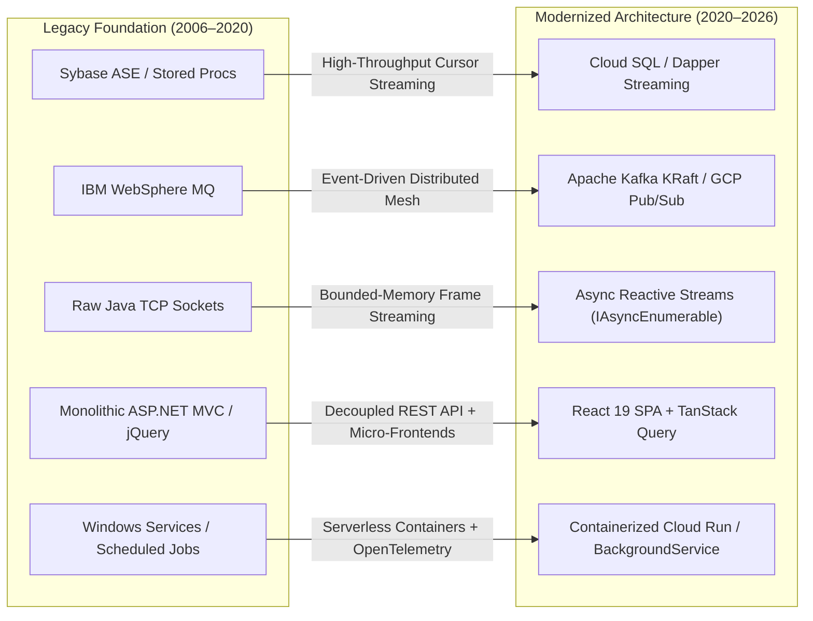
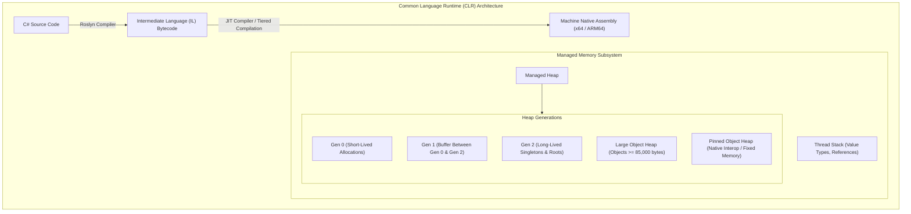
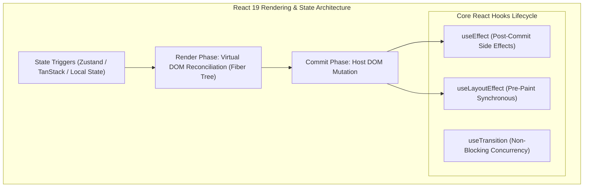
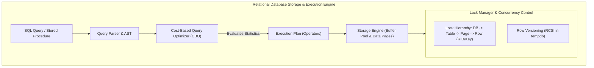
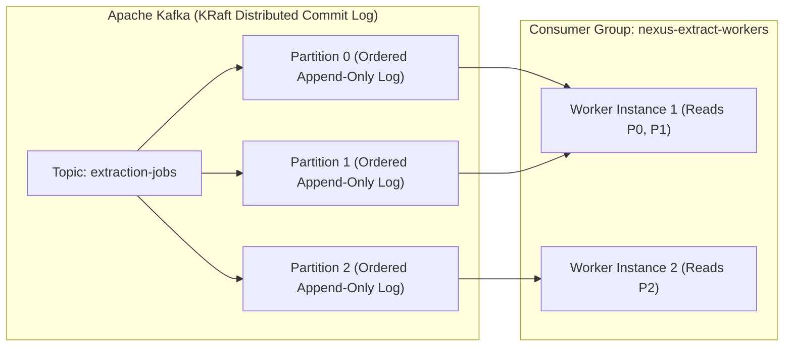
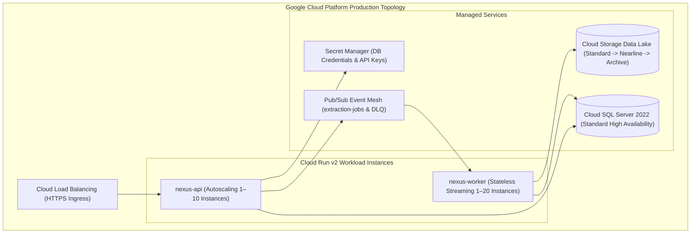
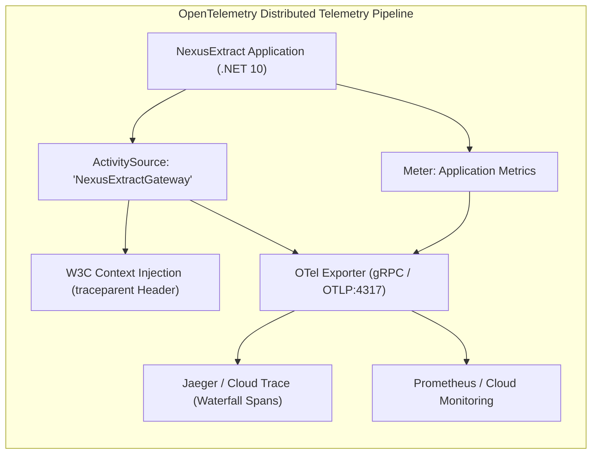
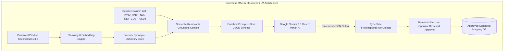

# Enterprise Software Architect & Technical Lead Interview Encyclopedia
### The Ultimate Master Revision Guide for Senior Engineering Leadership, Distributed Systems, Cloud Architecture & AI Integration

> **Candidate Profile:** Sanket Kambli | Associate Director – Software Engineering (20 Years Experience)  
> **Core Focus:** Enterprise .NET / C#, Distributed Architecture, High-Volume Data Streaming, SQL Optimization, Event Mesh (Kafka/PubSub/MQ), Cloud Native (GCP/Azure), Modern Frontend (React 19/TypeScript), and Enterprise AI Integration (Gemini 2.5 / RAG).

---

# Table of Contents
1. [Executive Profile & Interview Positioning Strategy](#1-executive-profile--interview-positioning-strategy)
2. [C# & .NET 10 Runtime Deep-Dive & CLR Internals](#2-c--net-10-runtime-deep-dive--clr-internals)
3. [Modern Frontend Architecture (React 19 & TypeScript)](#3-modern-frontend-architecture-react-19--typescript)
4. [Enterprise Database Systems, Storage & Query Tuning](#4-enterprise-database-systems-storage--query-tuning)
5. [Distributed Messaging, Event Mesh & Integration Protocols](#5-distributed-messaging-event-mesh--integration-protocols)
6. [Cloud Architecture, Infrastructure as Code & DevOps](#6-cloud-architecture-infrastructure-as-code--devops)
7. [Observability, OpenTelemetry & Reliability Engineering](#7-observability-opentelemetry--reliability-engineering)
8. [Enterprise Generative AI, RAG & LLM Integration](#8-enterprise-generative-ai-rag--llm-integration)
9. [Software Architecture Patterns & System Design Catalog](#9-software-architecture-patterns--system-design-catalog)
10. [Tools, Frameworks & Infrastructure Directory (Open Source vs Commercial)](#10-tools-frameworks--infrastructure-directory-open-source-vs-commercial)
11. [Cross-Examination Traps, Edge Cases & Failure Modes](#11-cross-examination-traps-edge-cases--failure-modes)
12. [Behavioral & Engineering Leadership Scenarios (STAR Method)](#12-behavioral--engineering-leadership-scenarios-star-method)

---

# 1. Executive Profile & Interview Positioning Strategy

## 1.1 Archetypes: How to Position 20 Years of Experience
Interviewers evaluate candidates based on distinct role expectations:

| Role Archetype | Primary Expectation | How to Answer in Interviews |
| :--- | :--- | :--- |
| **Solutions / Enterprise Architect** | System topology, non-functional requirements (NFRs), trade-offs, technology selection, cloud cost modeling, governance. | Lead with requirements, constraints, failure boundaries, and trade-offs. Use diagrams; avoid premature coding. Discuss CAP theorem, isolation levels, and data governance. |
| **Technical Lead / Lead Full Stack** | Hands-on code excellence, architecture patterns, PR reviews, concurrency, mentoring, CI/CD pipelines, debugging production issues. | Dive into code semantics, memory allocations (`Span<T>`, GC), React rendering cycles, deadlock graphs, and profiling tools (dotnet-dump, Jaeger). |
| **Associate Director / Engineering Manager** | Delivery execution, stakeholder alignment, team scaling, tech debt management, engineering KPIs (DORA metrics), cross-functional leadership. | Emphasize business value, risk mitigation, mentoring high-performing teams, modernizing legacy systems without downtime, and engineering standards. |

## 1.2 The "Legacy to Modern" Bridge Narrative
A key strength of a 20-year career is having engineered through multiple computing paradigms:
* **Legacy Experience (SS&C GlobeOp, Chenoa, Megasys):** C#, .NET Framework 2.0–4.8, ASP.NET MVC, Sybase ASE, SQL Server, IBM WebSphere MQ, Windows Services, WCF, raw TCP Java Sockets, jQuery, Kendo UI, SSRS.
* **Modernized Experience (Targeted & Project Demonstration):** .NET 10, C# 13/14, React 19, Vite, TanStack Query v5, Zustand, Apache Kafka KRaft, GCP Pub/Sub, Cloud Run, Terraform IaC, OpenTelemetry, Docker, Google Gemini 2.5 Structured Outputs, and RAG.



---

# 2. C# & .NET 10 Runtime Deep-Dive & CLR Internals



## 2.1 Common Language Runtime (CLR) & Execution Pipeline
1. **Compilation Phases:**
   * **Roslyn (C# Compiler):** Converts `.cs` source code into CIL (Common Intermediate Language) and metadata assemblies (`.dll`/`.exe`).
   * **RyuJIT (Just-In-Time Compiler):** Compiles IL into machine architecture instructions at runtime.
2. **Tiered Compilation (Tier 0 vs Tier 1) & Dynamic PGO:**
   * **Tier 0 (Quick JIT):** Compiles methods with zero optimizations to minimize application startup time. Installs call counters.
   * **Tier 1 (Optimized JIT):** If a method is invoked frequently (hot path), RyuJIT recompiles it using loop unrolling, register allocation, and inline expansion.
   * **Dynamic PGO (Profile-Guided Optimization):** Monitors runtime execution patterns (e.g. concrete types passed to interfaces) and devirtualizes interface calls into direct non-virtual machine branch calls.

## 2.2 Memory Management & Garbage Collection Mechanics
* **Generational Hypothesis:** Most objects die shortly after creation (Gen 0). Surviving objects promote from Gen 0 $\rightarrow$ Gen 1 $\rightarrow$ Gen 2.
* **GC Flavors:**
  * **Workstation GC:** Optimized for UI responsiveness and low latency on client machines.
  * **Server GC:** Creates a dedicated heap and GC thread per CPU core. Maximizes throughput for web servers and background workers.
  * **Background GC:** Replaces concurrent GC. Collects Gen 0 and Gen 1 concurrently while Gen 2 collection proceeds, avoiding thread freeze.
* **Large Object Heap (LOH):** Objects $\ge 85,000$ bytes bypass Gen 0 and allocate directly into LOH. LOH is traditionally not compacted during collection due to memory-copy cost, leading to heap fragmentation. In modern .NET, `GCSettings.LargeObjectHeapCompactionMode = GCLargeObjectHeapCompactionMode.CompactOnce` can force compaction.
* **Pinned Object Heap (POH):** Allocated via `GC.AllocateArray<T>(..., pinned: true)`. Keeps memory addresses fixed for socket/native OS interop without fragmenting Gen 0/1/2.

## 2.3 High-Throughput Memory Primitives: Span<T> & Memory<T>
* **`Span<T>`:** A `ref struct` living only on the stack. Represents a contiguous region of arbitrary memory (managed array, stack memory via `stackalloc`, or unmanaged pointer) without heap allocation:
  ```csharp
  // Zero-allocation substring parsing
  ReadOnlySpan<char> payload = "ORDER_ID:982341|QTY:500".AsSpan();
  int separatorIdx = payload.IndexOf('|');
  ReadOnlySpan<char> orderIdSpan = payload.Slice(9, separatorIdx - 9); // No string allocation!
  ```
* **`Memory<T>` / `ReadOnlyMemory<T>`:** Unlike `Span<T>`, `Memory<T>` is a standard `struct` and can live on the heap. Used across asynchronous boundary methods (`async/await`) where `ref struct` is forbidden by the compiler.

## 2.4 Asynchronous Plumbing: Task, ValueTask & State Machine Lowering
* When the compiler encounters an `async Task` method, it lowers the method into a generated `IAsyncStateMachine` struct:
  1. Creates a `TaskCompletionSource` or `AsyncTaskMethodBuilder`.
  2. Splits the method at each `await` point into state machine states (`state = 0, 1, 2...`).
  3. Registers the continuation on `Task.GetAwaiter().UnsafeOnCompleted()`.
* **`Task` vs `ValueTask<T>`:**
  * `Task` is a class (heap allocation).
  * `ValueTask<T>` is a struct. If an operation completes synchronously (e.g. data is in memory cache), `ValueTask` executes with **zero heap allocation**. Only allocates a `Task` if the operation genuinely yields asynchronously.

## 2.5 Concurrency, Locking & Synchronization Primitives
* **`lock(obj)`:** Syntactic sugar for `Monitor.Enter(obj)` and `Monitor.Exit(obj)`. Cannot be used across `await` statements.
* **`SemaphoreSlim`:** Lightweight async-compatible semaphore. Limits concurrent access: `await semaphore.WaitAsync(ct)`.
* **`Channel<T>`:** High-performance, concurrent producer-consumer queue supporting backpressure via `BoundedChannelOptions` with `FullMode.Wait` or `FullMode.DropOldest`.
* **`Interlocked`:** Hardware-level atomic primitives (`Increment`, `CompareExchange`, `Add`) executing in a single CPU instruction cycle without kernel locks.

---

# 3. Modern Frontend Architecture (React 19 & TypeScript)



## 3.1 React 19 Core Mental Model & Fiber Engine
* **Virtual DOM & Fiber Architecture:**
  * A React **Fiber** is a plain JavaScript object representing a unit of work with references to child, sibling, and parent nodes (`return`).
  * The Fiber architecture splits reconciliation into two distinct phases:
    1. **Render Phase (Interruptible):** Work can be paused, prioritized, or discarded. Compares existing Fiber tree with new JSX tree.
    2. **Commit Phase (Non-interruptible):** Applies calculated DOM updates synchronously.
* **React 19 Enhancements:**
  * **Actions & `useActionState`:** Built-in form submission handling with automatic pending states and optimistic updates.
  * **`useOptimistic`:** Instantly mutates UI ahead of server API confirmation, automatically rolling back on HTTP failure.
  * **Ref as a Prop:** Replaces boilerplate `forwardRef` wrapping; components accept `ref` directly as a parameter.

## 3.2 State Management Taxonomy: Local vs Server vs Global
* **Server State (TanStack Query v5):**
  * Handles asynchronous API caching, deduplication, background re-fetching, and optimistic mutations.
  * Stale-While-Revalidate caching pattern: Displays cached data immediately while firing a background HTTP request to update cache.
* **Global Client State (Zustand):**
  * Lightweight (under 1 KB), hook-based state store outside the React context tree.
  * Solves the **Context API re-render problem**: Components only re-render when their specific sliced selector value changes:
    ```typescript
    const userRole = useStore(state => state.userRole); // Only re-renders if userRole changes!
    ```

## 3.3 TypeScript Strict Mode Encyclopedia
* **Generics & Constraints:** `<T extends Record<string, unknown>>`
* **Mapped & Conditional Types:** `type Nullable<T> = { [K in keyof T]: T[K] | null }`
* **Discriminated Unions:**
  ```typescript
  type JobResult = 
    | { status: 'Success'; data: string[]; bytesWritten: number }
    | { status: 'Failed'; error: string; retryCount: number };
  ```
* **`unknown` vs `any` vs `never`:**
  * `any`: Disables type checking entirely.
  * `unknown`: Type-safe counterpoint to `any`. Cannot perform operations without explicit type narrowing.
  * `never`: Represents values that can never occur (exhaustive switch check default).

---

# 4. Enterprise Database Systems, Storage & Query Tuning



## 4.1 Indexing Mechanics: Clustered vs Non-Clustered B-Trees
* **Clustered Index:**
  * Physically orders and stores the actual data rows at the leaf level of the B-Tree.
  * A table can have only **one** clustered index. Best placed on unique, sequential, non-updating keys (e.g. `BIGINT IDENTITY` or timestamp).
* **Non-Clustered Index:**
  * Contains index key columns and a pointer (clustering key or RID) to the physical row.
  * **Covering Index (`INCLUDE`):** Adds non-key columns to leaf nodes to satisfy a `SELECT` query completely without performing costly bookmark/key lookups to the clustered index:
    ```sql
    CREATE NONCLUSTERED INDEX IX_Jobs_Status_CreatedAt 
    ON ExtractionJobs (Status, CreatedAtUtc)
    INCLUDE (TargetOutputPath, ChecksumSha256, BytesExtracted);
    ```

## 4.2 ACID, Transaction Isolation Levels & RCSI
1. **Read Uncommitted:** Dirty reads, non-repeatable reads, phantom reads permitted. Zero shared locks acquired.
2. **Read Committed (Default SQL Server):** Acquires Shared (S) locks while reading; releases them immediately after row is processed. Blocks readers on uncommitted writers.
3. **Read Committed Snapshot Isolation (RCSI):**
   * Eliminates reader-writer blocking by using row versioning stored in `tempdb`.
   * Readers read the last committed snapshot before the query began, eliminating shared locking without dirty reads:
     ```sql
     ALTER DATABASE NexusExtractDb SET READ_COMMITTED_SNAPSHOT ON;
     ```
4. **Repeatable Read:** Holds Shared locks until the transaction ends. Prevents non-repeatable reads; phantom reads still possible.
5. **Serializable:** Places Range-Locks (Key-Range) preventing other transactions from inserting or modifying rows in the scanned range. Eliminates phantom reads at the expense of severe lock contention.

## 4.3 Deadlock Diagnosis & Resolution
* **The Mechanism:** Transaction A locks Resource 1 and requests Resource 2; Transaction B locks Resource 2 and requests Resource 1.
* **SQL Server / Sybase Deadlock Engine:** The Lock Monitor thread executes every 5 seconds. When a cycle is detected, it terminates the transaction with the lowest rollback cost with **Error 1205**:
  ```
  Msg 1205, Level 13, State 45: Transaction was deadlocked on lock resources with another process and has been chosen as the deadlock victim. Rerun the transaction.
  ```
* **Trace Flags 1204 & 1205:** Configures SQL Server to print detailed XML deadlock graphs to the error log, detailing victim SPIDs, query text, and locked resources.

## 4.4 Dapper vs Entity Framework Core: Architectural Trade-Off Matrix

| Dimension | Dapper (Micro-ORM) | Entity Framework Core (Full ORM) |
| :--- | :--- | :--- |
| **Philosophy** | "King of Raw Throughput" — executes raw parameterized SQL directly over ADO.NET. | "Productivity & Domain Model Mapping" — rich change tracking, migrations, LINQ provider. |
| **Change Tracking** | None. Manual `UPDATE` statements required. | Automatic snapshot or proxy-based entity tracking. |
| **Memory Allocation** | Minimal (streams records directly via `IDataReader`). | Significant overhead maintaining navigation graphs, states, and entity dictionaries. |
| **Streaming Large Datasets** | Supports `CommandBehavior.SequentialAccess` streaming with bounded RAM (< 150 MB). | Reads entire entities into memory context unless configured with `AsNoTracking()` and raw streaming queries. |
| **Best Used For** | High-throughput streaming, reporting, audit logging, CQRS Read Models. | Core domain aggregate persistence, transactional CRUD, relational navigation graphs. |

---

# 5. Distributed Messaging, Event Mesh & Integration Protocols



## 5.1 Apache Kafka Architecture & Internals
* **Distributed Append-Only Commit Log:** Messages are written sequentially to segment files on disk, leveraging sequential OS disk I/O and page cache.
* **Partitioning & Ordering Guarantee:** Ordering is guaranteed **only within a partition**, never across an entire topic. Partition assignment is determined by the hash of the message key:
  $$\text{Partition} = \text{Murmur2}(\text{Key}) \pmod{\text{NumPartitions}}$$
* **KRaft Mode (Kafka without ZooKeeper):** Replaces ZooKeeper metadata cluster with an event-driven consensus protocol based on Raft. Eliminates metadata synchronization latency and scales topics to millions of partitions.
* **Consumer Group Rebalancing:**
  * **Eager Rebalance:** Revokes all partition assignments across all consumers before reassigning. Halts entire message processing pipeline.
  * **Cooperative Sticky Rebalance:** Revokes only the specific partitions migrating between consumers, allowing untouched consumers to process uninterrupted.

## 5.2 IBM WebSphere MQ vs Apache Kafka vs GCP Pub/Sub

| Feature | IBM WebSphere MQ | Apache Kafka | Google Cloud Pub/Sub |
| :--- | :--- | :--- | :--- |
| **Model** | Message Broker (Store & Forward). | Distributed Commit Log. | Serverless Global Event Mesh. |
| **Message Deletion** | Deleted from queue immediately upon consumer acknowledgement (`MQGET` commit). | Persisted in log until retention policy expires (Time/Size/Compaction). Re-readable by multiple consumers. | Retained until acknowledged or subscription deadline expires. Supports dead-lettering. |
| **Ordering** | FIFO guaranteed per queue. | Strict FIFO **per partition** only. | Best-effort by default; strict ordering requires ordering keys. |
| **Scalability** | Scale-up (vertical). Clustered queue managers. | Scale-out (horizontal) across partitions and brokers. | Auto-scaling managed serverless cloud infrastructure. |

## 5.3 Legacy Protocol Integrations
* **Geneva Java TCP Socket Streaming:**
  * Protocol uses length-prefixed framing: `[4-Byte Big-Endian Length][Payload Bytes]`.
  * The .NET adapter reads exactly 4 bytes to determine frame length, reads payload into `Memory<byte>`, and streams records until a zero-length frame (End of Stream) is received.
* **Partner SFTP Drop with Handshake:**
  * Asynchronous file drop exchange: System uploads control file `REQ_<jobId>.ctl` to `/inbound/`.
  * Periodically polls `/outbound/` for partner response `RESP_<jobId>.csv` with a configurable SLA watchdog timer before timeout escalation.

---

# 6. Cloud Architecture, Infrastructure as Code & DevOps



## 6.1 Google Cloud Platform (GCP) Serverless Architecture
* **Cloud Run v2 vs Kubernetes (GKE):**
  * Cloud Run provides serverless container execution with near-instant autoscaling (0 to 20+ instances based on CPU and concurrency), native GCP IAM workload identity, and zero cluster maintenance overhead.
  * Stateless workers processing asynchronous streaming tasks to GCS achieve optimal cost efficiency without maintaining idle VM node pools.
* **Cloud Storage Lifecycle Policies:**
  * New files land in `STANDARD` storage class for rapid access.
  * Lifecycle policy transitions objects to `NEARLINE` after 90 days (lowering storage cost by ~50%).
  * Automated deletion rule purges temporary raw dumps after 365 days.

## 6.2 Terraform Infrastructure as Code (IaC) Standards
* **Declarative Idempotency:** Running `terraform apply` calculates execution plan (`tfplan`) against current remote state and only modifies drifted resources.
* **Least-Privilege Workload Identity:** A dedicated Service Account (`nexus-extract-sa`) is provisioned with granular IAM bindings:
  * `roles/pubsub.publisher` & `roles/pubsub.subscriber`
  * `roles/storage.objectAdmin` (scoped strictly to target bucket)
  * `roles/cloudsql.client`
  * `roles/cloudtrace.agent`

## 6.3 Multi-Stage Containerization & CI/CD Pipelines
* **Hardened Dockerfiles:**
  * Uses `mcr.microsoft.com/dotnet/sdk:10.0` for cached layer compilation and `aspnet:10.0` for minimal runtime attack surface.
  * Enforces rootless execution (`USER $APP_UID`) in compliance with CIS benchmarks.
* **Bitbucket Pipelines:**
  * PR Stage: Unit tests + TypeScript compile checks.
  * Security Stage: **Trivy** vulnerability scanner inspecting container images for `CRITICAL` or `HIGH` CVEs before pushing to Google Artifact Registry.

---

# 7. Observability, OpenTelemetry & Reliability Engineering



## 7.1 The Three Pillars & OpenTelemetry Standards
* **OpenTelemetry (OTel):** The CNCF vendor-neutral observability standard replacing proprietary vendor SDKs (Dynatrace, AppDynamics, Datadog).
* **Distributed Tracing Protocol (W3C Trace Context):**
  * `traceparent`: `00-4bf92f3577b34da6a3ce929d0e0e4736-00f067aa0ba902b7-01`
    * `00`: Version.
    * `4bf92f...`: 16-byte **Trace ID** (constant across the entire distributed operation).
    * `00f067...`: 8-byte **Span ID** (identifies current sub-operation).
    * `01`: Trace flags (sampled).

## 7.2 Custom Metric Instruments (`System.Diagnostics.Metrics`)
* **Counter:** Monotonically increasing metric (e.g. `nexus_jobs_started_total`, `nexus_bytes_streamed_total`).
* **UpDownCounter:** Gauge representing active state (e.g. `nexus_active_jobs`).
* **Histogram:** Measures statistical distribution of values over time (e.g. `nexus_job_duration_seconds` percentiles $p_{50}, p_{95}, p_{99}$).

## 7.3 Dead-Letter Queue (DLQ) & Fault Tolerance
* **Polly Exponential Backoff:** Re-attempts transient errors with exponential delay ($2^{\text{attempt}}$ seconds) + jitter to prevent retry storms.
* **Dead-Letter Eviction:** After $N$ failed attempts, the message is evicted to `extraction-jobs-dlq`, preserving main queue throughput.
* **Message Replay:** Operators use the Support Console to trigger `POST /api/v1/extractions/jobs/{id}/replay`, resetting retry counts and re-enqueuing the job safely without duplicate file writes.

---

# 8. Enterprise Generative AI, RAG & LLM Integration



## 8.1 Retrieval-Augmented Generation (RAG) Architecture
* **The Problem:** Direct LLM prompting hallucinates column associations and invents non-existent database fields.
* **The Solution:** RAG grounds the prompt with factual canonical data dictionary specifications:
  1. Retrieves matching canonical field definitions, data types, and known historical supplier aliases.
  2. Injects retrieved specification directly into the LLM system prompt.
  3. Forces LLM to select target fields **only from the provided canonical set**.

## 8.2 Google Gemini 2.5 Structured JSON Outputs
* Utilizes `response_mime_type: "application/json"` with formal `response_schema`.
* Guarantees typed JSON response matching domain contract:
  ```json
  {
    "mappings": [
      {
        "sourceColumn": "VND_PART_NO",
        "targetCanonicalField": "ManufacturerPartNumber_MPN",
        "confidenceScore": 0.95,
        "transformationRule": "Trim",
        "aiRationale": "Matched via enterprise RAG synonym dictionary."
      }
    ]
  }
  ```

## 8.3 Human-in-the-Loop (HITL) Governance & Cost Controls
* In enterprise architectures, AI **recommends**; human operators **commit**.
* React UI surfaces confidence badges and allows operators to override matches before committing to production pipelines.
* AI usage logging tracks prompt/completion tokens and estimated USD costs per session for budgeting and auditing.

---

# 9. Software Architecture Patterns & System Design Catalog

| Architecture Pattern | Where Applied in NexusExtract | Production Problem Solved |
| :--- | :--- | :--- |
| **Ports & Adapters (Hexagonal)** | `IDataSourceAdapter` & `IFileSink` interfaces | Isolates core domain logic from external transport dependencies (sockets, databases, SFTP). |
| **Open-Closed Principle (OCP)** | `DataSourceAdapterFactory` DI registration | Enables adding a 5th source (e.g. Snowflake) with zero changes to existing worker code. |
| **Reactive Streaming Pipeline** | `IAsyncEnumerable<DataChunk>` | Streams hundreds of gigabytes through memory with bounded footprint (< 150 MB RAM). |
| **Dead-Letter Channel** | `extraction-jobs-dlq` topic | Isolates malformed or poisoned payloads without stalling active queue consumers. |
| **Transactional Outbox** | Database audit + Message publish | Guarantees atomic database state and message bus dispatch without dual-write inconsistency. |
| **Result Pattern** | `Result<T>` functional return type | Eliminates costly exception throwing for anticipated validation and operational failures. |
| **Ambient Context / Tracer** | `CorrelationIdMiddleware` + `ActivitySource` | Injects and correlates unique Trace IDs across UI, API, Kafka, Worker, and DB audit logs. |

---

# 10. Tools, Frameworks & Infrastructure Directory

| Tool / Technology | Category | License / Cost Model | Production Purpose & Configuration |
| :--- | :--- | :--- | :--- |
| **C# / .NET 10** | Backend Framework | **Open Source (MIT)** — Free | High-performance compiled backend runtime. Built with SDK 10.0, ASP.NET Core, and generic hosts. |
| **React 19** | Frontend Framework | **Open Source (MIT)** — Free | Component UI library utilizing Concurrent Fiber rendering, Vite 6, and TypeScript strict mode. |
| **Material UI (MUI v6)** | UI Component Library | **Open Source (MIT)** (Core) — Free | Enterprise component library providing tables, modals, themes, and accessible form controls. |
| **TanStack Query v5** | Server State Management | **Open Source (MIT)** — Free | Asynchronous query caching, automatic re-fetching, deduplication, and optimistic UI mutations. |
| **Zustand** | Global Client State | **Open Source (MIT)** — Free | Fast, un-opinionated state store utilizing sliced selectors to eliminate unnecessary component re-renders. |
| **Apache Kafka** | Distributed Streaming | **Open Source (Apache 2.0)** — Free | High-throughput distributed append-only commit log. Configured in KRaft mode (no ZooKeeper). |
| **Google Cloud Pub/Sub** | Cloud Event Mesh | **Commercial (GCP Paid)** (Pay-per-GiB) | Managed serverless message bus supporting push/pull subscriptions and automated dead-letter routing. |
| **Google Cloud Run v2** | Serverless Container Host | **Commercial (GCP Paid)** (Pay-per-vCPU/Sec) | Fully managed serverless container runtime running API and streaming workers with autoscaling 0 to 20+. |
| **Google Cloud SQL** | Relational Database | **Commercial (GCP Paid)** (Per Instance/Storage) | Managed SQL Server 2022 Standard database configured with automated backups and deadlock trace flags. |
| **Google Cloud Storage** | Object Storage / Data Lake | **Commercial (GCP Paid)** (Per GiB/Month) | Highly scalable blob storage with lifecycle policies transitioning older objects to Nearline. |
| **Google Gemini 2.5 Flash** | Large Language Model | **Commercial (GCP Paid)** ($0.075/1M Input Tokens) | High-speed, multimodal LLM generating structured JSON schema reconciliations. |
| **MinIO** | Object Storage (S3 API) | **Open Source (AGPL v3)** — Free for Local | High-performance S3-compatible local object store used for local development and integration tests. |
| **Dapper** | Micro-ORM | **Open Source (Apache 2.0)** — Free | High-speed object mapper executing raw parameterized ADO.NET SQL queries directly. |
| **OpenTelemetry (OTel)** | Observability SDK | **Open Source (Apache 2.0)** — Free | Vendor-neutral instrumentation standard for distributed tracing (`ActivitySource`) and metrics (`Meter`). |
| **Jaeger** | Distributed Tracing UI | **Open Source (Apache 2.0)** — Free | Visualizer for OpenTelemetry distributed trace waterfalls (`http://localhost:16686`). |
| **Terraform** | Infrastructure as Code | **Open Source / BSL** — Free CLI | Declarative cloud provisioning tool managing GCP IAM, Cloud Run, Pub/Sub, and Cloud SQL resources. |
| **Bitbucket Pipelines** | CI/CD Automation | **Commercial (Atlassian)** (Free tier available) | Cloud CI/CD pipeline executing unit tests, Trivy vulnerability scans, and Terraform deployments. |
| **Trivy** | Security Scanner | **Open Source (Apache 2.0)** — Free | Container image and filesystem vulnerability scanner detecting CVEs in CI/CD before deployment. |
| **Polly** | Resilience & Transient Faults | **Open Source (BSD-3-Clause)** — Free | .NET resilience library providing retries, circuit breakers, rate limiters, and fallback policies. |

---

# 11. Cross-Examination Traps, Edge Cases & Failure Modes

### Trap 1: "Why not use Entity Framework Core everywhere instead of mixing Dapper?"
* **Naive Answer:** "Dapper is faster."
* **Architect Answer:** "It's an intentional architectural trade-off based on CQRS and memory boundaries. Entity Framework Core is exceptional for domain modeling, rich business rules, change tracking, and transactional integrity. However, during large data extractions streaming millions of rows, EF Core's Change Tracker introduces significant allocation overhead, object graph snapshotting, and garbage collection pressure. Dapper executes raw, parameterized ADO.NET queries directly via `IDataReader` with `SequentialAccess`, streaming bytes directly from the network buffer into the sink with zero change-tracking overhead. We use EF Core where domain complexity dominates, and Dapper where raw streaming throughput and memory bounds dominate."

### Trap 2: "If Kafka partition ordering is guaranteed only per partition, how do you handle ordering across an entire extraction job?"
* **Naive Answer:** "We put everything in one partition."
* **Architect Answer:** "Putting everything in one partition destroys consumer concurrency and creates a hot broker bottleneck. Instead, we partition by **JobId** or **SupplierId** as the message key. All events and chunks belonging to a specific extraction job hash deterministically to the same partition, guaranteeing strict FIFO order for that entity, while different extraction jobs distribute evenly across all partitions for maximum horizontal parallelism."

### Trap 3: "How do you prevent a slow destination storage sink from crashing the source extraction with an Out-Of-Memory error?"
* **Naive Answer:** "We add more RAM to the server."
* **Architect Answer:** "We enforce **Reactive Backpressure** using asynchronous pulling (`IAsyncEnumerable<DataChunk>`). In this architecture, the sink controls the pulling rate. The source adapter does not push chunks unconstrained into an unbounded memory queue; it only reads the next frame from the network socket or database cursor when the destination sink has completed writing and flushed the previous chunk to disk or S3. If the destination storage experiences latency, the socket TCP receive window fills up, automatically signaling the sender to throttle at the transport layer, keeping memory utilization strictly under 150 MB."

---

# 12. Behavioral & Engineering Leadership Scenarios (STAR Method)

### Scenario 1: A Critical Production Outage in a High-Volume Financial System
* **Situation:** During end-of-quarter regulatory reporting, a critical data extraction pipeline stalled, accumulating deadlocks and causing downstream reporting SLA breaches for institutional asset managers.
* **Task:** As Engineering Lead, I needed to identify the root cause, restore system processing immediately without data loss, and establish a permanent architectural fix.
* **Action:** I initiated incident command, enabled SQL trace flags 1204/1205, and isolated the deadlock graph. I discovered that concurrent bulk audit logging was escalating to table-level exclusive locks, blocking transactional readers. I immediately implemented Read Committed Snapshot Isolation (RCSI) to eliminate reader-writer lock contention. In the application layer, I replaced row-by-row synchronous log writes with an asynchronous buffered `Channel<T>` worker using Dapper bulk inserts.
* **Result:** Restored full processing throughput within 45 minutes with zero data corruption. Subsequent quarterly filing executed with a 65% reduction in database lock wait times.

### Scenario 2: Resolving a Disagreement Over Microservices vs Modular Monolith
* **Situation:** A team of developers proposed decomposing an existing data processing platform into 15 individual microservices, each with its own repository and database.
* **Task:** Evaluate the proposal and align the team on an architecture that met performance requirements without introducing premature distributed complexity.
* **Action:** I led an architectural review session evaluating the Non-Functional Requirements (NFRs). I demonstrated that 15 microservices would introduce dual-write distributed transaction problems (requiring 2PC or Sagas), distributed network latency across large streaming payloads, and substantial CI/CD maintenance overhead for our team size. Instead, I proposed a **Modular Monolith** using Clean Architecture: strong domain boundary enforcement via internal assemblies, unified database schemas with clear bounded contexts, and asynchronous event communication via an in-memory `Channel<T>` bus that could be swapped for Kafka when horizontal scaling demanded it.
* **Result:** The team unanimously backed the modular monolith design. Delivery was completed 2 months ahead of schedule, with seamless transition to Kafka workers when multi-instance scaling was later introduced.
