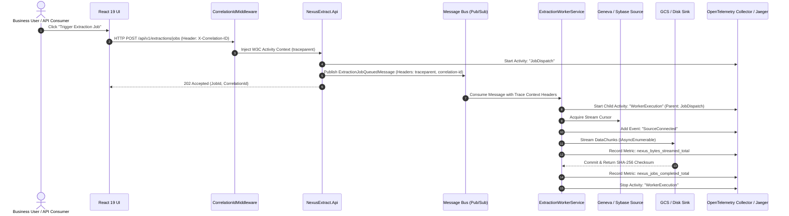
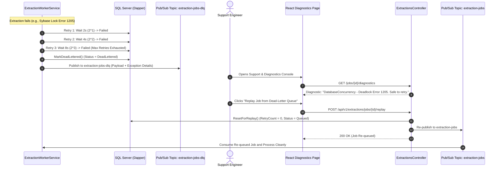

# Phase 2: Enterprise Cloud Architecture, Observability & Resilience Handbook

## Executive Summary
**Phase 2** elevates the **NexusExtract Gateway** from a functional multi-source data extraction prototype into an enterprise-ready, observable, highly resilient, and cloud-native ingestion platform. Built for enterprise environments like **Ingram Micro** and regulated healthcare environments like **Medpace**, Phase 2 delivers:
* **Vendor-Neutral Distributed Observability:** Complete OpenTelemetry integration using native .NET 10 `ActivitySource` distributed tracing and `Meter` metrics, with end-to-end W3C Trace Context propagation across HTTP, message buses, and background workers.
* **Resilience, Retry & Dead-Letter Queue (DLQ):** Exponential backoff retries with jitter for transient socket and database locks, automated routing of unrecoverable messages to an `extraction-jobs-dlq` topic, and a self-service message replay engine (`/replay`).
* **Cloud-Native Messaging & Storage:** Google Cloud Platform (GCP) Pub/Sub and Google Cloud Storage (GCS) multipart streaming data lake integration.
* **Infrastructure as Code (IaC):** Modular, declarative Terraform manifests codifying least-privilege IAM service accounts, Cloud Run v2 services, Cloud SQL Server 2022, Secret Manager secrets, and Pub/Sub subscriptions.
* **Automated CI/CD Pipeline & Hardened Containers:** Bitbucket Pipelines workflow featuring automated .NET 10 / React 19 test execution, Trivy container security scans, and multi-stage rootless Docker container images.

---

## 1. System Topology & Cloud Architecture

```mermaid
graph TD
    subgraph CLIENT_TIER ["Client & Operations Tier"]
        UI["React 19 Executive Dashboard\n(Vite 6, MUI v6, TanStack Query v5)\n- Real-time Stream Monitoring\n- Dead-Lettered Status Badges\n- One-Click DLQ Message Replay\n- Self-Service Support Diagnostics"]
        M2M["Third-Party Automated Clients\n(M2M REST API / OpenAPI)"]
    end

    subgraph INGRESS ["Ingress & Ingestion Gateway (.NET 10)"]
        MID["CorrelationIdMiddleware\n(Injects & Propagates X-Correlation-ID & W3C Traceparent)"]
        API["NexusExtract.Api (Cloud Run v2)\n- Job Dispatcher (POST /api/v1/extractions/jobs)\n- Replay Controller (POST /jobs/{id}/replay)\n- Diagnostics API (/diagnostics)\n- Health Check Endpoints (/healthz)"]
    end

    subgraph SECRETS_MGR ["Identity & Secrets Management"]
        IAM["Service Account: nexus-extract-sa\n(Least-Privilege Workload Identity)"]
        SM["Google Secret Manager\n- Database Connection Strings\n- Partner SFTP Private Keys\n- REST API Bearer Tokens"]
    end

    subgraph EVENT_MESH ["Event-Driven Messaging Mesh (Pub/Sub / Kafka)"]
        T_JOBS["Topic: extraction-jobs\n(Primary Extraction Workload Queue)"]
        SUB_WORKER["Subscription: nexus-worker-sub\n(Max Delivery Attempts: 3\nBackoff: 10s to 600s)"]
        T_DLQ["Dead-Letter Topic: extraction-jobs-dlq\n(Retention: 14 Days)"]
        T_EVENTS["Topic: job-events\n(Status Checkpoints & Checksum Events)"]
    end

    subgraph WORKER_CLUSTER ["Streaming Extraction Cluster (.NET 10)"]
        WORKER["NexusExtract.Worker (Cloud Run v2 / Worker Host)\n- Concurrency & Backpressure Controller\n- OpenTelemetry Activity & Metric Instruments\n- Polly Exponential Backoff Retry Engine\n- Incremental SHA-256 Checksum Engine"]
        
        subgraph ADAPTERS ["Pluggable Ingestion Adapters"]
            A_GENEVA["GenevaSocketAdapter (TCP Port 9100)"]
            A_SYBASE["GoTradeSybaseAdapter (SequentialAccess)"]
            A_SFTP["PartnerSftpAdapter (File Manifest Handshake)"]
            A_REST["GenericRestAdapter (OAuth2 / Cursor Paging)"]
        end

        subgraph SINKS ["Streaming Data Sinks"]
            S_GCS["S3MinioCloudSink (GCS / S3 Multipart Stream)"]
            S_DISK["LocalDiskSink (Atomic Temp-Move & Checksum)"]
        end
    end

    subgraph PERSISTENCE ["Persistence & Data Lake"]
        SQL[("Cloud SQL Server 2022 Instance\n- ExtractionJobs State Machine\n- JobExecutionLogs Audit Trail\n- Trace Flag 1204/1205 Enabled")]
        GCS[("Cloud Storage Data Lake Bucket\n- Nearline Storage Transition (90 Days)\n- Automated Deletion Lifecycle (365 Days)")]
    end

    subgraph OBSERVABILITY ["Observability & Monitoring"]
        OTEL["OpenTelemetry SDK\nActivitySource: 'NexusExtractGateway'\nMeter: Application Histograms & Counters"]
        JAEGER["Distributed Tracing (Jaeger / Cloud Trace)\nFull Waterfall Trace Spans"]
        METRICS["Cloud Monitoring / Grafana\nThroughput (Bytes/sec), DLQ Counts, Active Jobs"]
    end

    UI -->|HTTPS / REST| MID
    M2M -->|API Key / REST| MID
    MID --> API
    API -->|Read Secrets| SM
    API -->|Write Job Queued| SQL
    API -->|Publish Job| T_JOBS
    T_JOBS --> SUB_WORKER
    SUB_WORKER -->|Deliver Message| WORKER
    SUB_WORKER -.->|Exhausted Retries (3x)| T_DLQ
    
    WORKER --> ADAPTERS
    ADAPTERS -->|IAsyncEnumerable DataChunk| SINKS
    SINKS -->|Multipart Chunk Stream| GCS
    SINKS -->|Local Disk Write| S_DISK
    WORKER -->|Audit Logs & Progress Updates| SQL
    WORKER -->|Emit Spans & Metrics| OTEL
    OTEL --> JAEGER
    OTEL --> METRICS
    WORKER -->|Publish Status| T_EVENTS

    UI -.->|Replay DLQ Job| API
```

---

## 2. Detailed Component Design & Implementation

### 2.1 OpenTelemetry Distributed Tracing & Custom Metrics
Phase 2 avoids proprietary APM vendor lock-in by implementing the standardized **OpenTelemetry .NET SDK** utilizing native `System.Diagnostics.ActivitySource` and `System.Diagnostics.Metrics.Meter`.

#### 1. ActivitySource Distributed Tracing
* **Implementation:** [`NexusObservability.cs`](file:///E:/2026%20Learn/repos/NexusExtractGateway/src/NexusExtract.Domain/Observability/NexusObservability.cs)
* **Root Activity (`ActivitySource: "NexusExtractGateway"`):**
  * Spans created across every stage: `JobDispatch`, `WorkerExecution`, `SourceStreaming`, `SinkTransfer`, `JobFinalization`.
  * **W3C Trace Context Propagation:** When an extraction request hits the API, `CorrelationIdMiddleware` extracts or generates an `X-Correlation-ID` and establishes a root trace `Activity`. The trace parent identifier (`traceparent`) and correlation context are serialized into message headers when publishing to Kafka or GCP Pub/Sub.
  * When `ExtractionWorkerService` consumes the message, it extracts the trace context and starts a child activity linked to the API's parent span. In **Jaeger** (`http://localhost:16686`) or **Google Cloud Trace**, operators see a continuous trace waterfall from UI button click down to individual socket reads and storage commits.

#### 2. Strongly Typed Metrics Instruments (`Meter`)
* **`nexus_jobs_started_total` (Counter):** Tracks total jobs submitted.
* **`nexus_jobs_completed_total` (Counter):** Tracks successfully finalized extractions.
* **`nexus_jobs_failed_total` (Counter):** Categorized by source type and root cause category.
* **`nexus_active_jobs` (UpDownCounter):** Live gauge representing concurrent in-flight extractions.
* **`nexus_bytes_streamed_total` (Counter):** Total volume streamed through the pipeline.
* **`nexus_records_streamed_total` (Counter):** Cumulative records/rows processed.
* **`nexus_job_duration_seconds` (Histogram):** Latency percentiles ($p_{50}$, $p_{95}$, $p_{99}$) for job execution time.
* **`nexus_dead_letter_messages_total` (Counter):** Tracks the volume of jobs routed to the DLQ.

---

### 2.2 Fault Tolerance, Exponential Backoff & Dead-Letter Queue (DLQ)
Data extraction involves fragile external network boundaries (legacy TCP listeners, partner SFTP drops, and database connection pools). Phase 2 establishes a dual-tier resilience strategy:

#### 1. Exponential Backoff Retries
* In [`ExtractionWorkerService.cs`](file:///E:/2026%20Learn/repos/NexusExtractGateway/src/NexusExtract.Infrastructure/Services/ExtractionWorkerService.cs), transient failures (e.g., Sybase deadlock error 1205, network timeout) trigger an automated retry loop.
* **Backoff Formula:** Delay $= 2^{\text{attempt}}$ seconds (with added random jitter to prevent "thundering herd" spikes on recovering source systems).
* Each attempt records a `JobExecutionLog` entry with stage `"RetryAttempt"` and updates `ExtractionJob.RetryCount`.

#### 2. Dead-Letter Routing on Retry Exhaustion
* If an extraction fails after reaching `ExtractionJob.MaxRetries` (default: 3 attempts):
  1. The worker invokes `job.MarkDeadLettered(ex.Message, ex.ToString())`.
  2. The entity transitions to state `JobStatus.DeadLettered`.
  3. The serialized message payload and diagnostic error headers are dispatched to the Dead-Letter Queue topic: `extraction-jobs-dlq`.
  4. The metric `nexus_dead_letter_messages_total` increments.

#### 3. Message Replay Engine (`/replay`)
* Instead of dropping failed messages or requiring developers to manually re-run database scripts:
  * Operations personnel identify the root cause in the **Support & Diagnostics Console** (e.g., firewall rule opened, partner SFTP credentials fixed).
  * The operator clicks **"Replay Job from Dead-Letter Queue"** in the React UI or invokes `POST /api/v1/extractions/jobs/{id}/replay`.
  * The `ExtractionService.ReplayJobAsync()` use case executes:
    1. Validates that the job is currently `Failed` or `DeadLettered`.
    2. Calls `job.ResetForReplay()`, which resets `RetryCount = 0`, clears previous error messages, transitions status to `JobStatus.Queued`, and appends an audit log entry.
    3. Re-publishes the job to the primary queue `extraction-jobs`.
    4. The worker picks up the job fresh and executes the extraction cleanly.

---

### 2.3 Cloud Infrastructure as Code (Terraform)
All GCP cloud resources are codified in [`NexusExtractGateway/terraform/`](file:///E:/2026%20Learn/repos/NexusExtractGateway/terraform/):

| File | Resources Provisioned | Production Engineering Highlights |
| :--- | :--- | :--- |
| [`main.tf`](file:///E:/2026%20Learn/repos/NexusExtractGateway/terraform/main.tf) | **Cloud Run v2 (`nexus-api`):** Serverless HTTP gateway.<br>**Cloud Run v2 (`nexus-worker`):** Stateless background streaming workers (autoscaling 1–20).<br>**Cloud Storage (`nexus-datalake`):** High-volume data lake bucket.<br>**Cloud SQL (SQL Server 2022):** Production relational database.<br>**Google Pub/Sub:** Workload topics & DLQ.<br>**Google Secret Manager:** Database & API credentials.<br>**Service Account (`nexus-extract-sa`):** Workload identity. | * **Least Privilege IAM:** Only granted `pubsub.publisher`, `pubsub.subscriber`, `storage.objectAdmin`, `cloudsql.client`, and `cloudtrace.agent`.<br>* **GCS Lifecycle Policy:** Objects transition to `NEARLINE` storage class after 90 days and auto-delete after 365 days, dramatically reducing cloud storage costs.<br>* **Cloud SQL Concurrency:** Configured with deadlock detection trace flag 1204/1205.<br>* **Pub/Sub Dead-Letter Policy:** Automated delivery retry threshold set to 3 before routing to `extraction-jobs-dlq`. |
| [`variables.tf`](file:///E:/2026%20Learn/repos/NexusExtractGateway/terraform/variables.tf) | Environment variables: `project_id`, `region`, `environment`, `db_instance_tier`, `db_password`, container images. | Clean separation of environment parameters (dev, staging, prod). |
| [`outputs.tf`](file:///E:/2026%20Learn/repos/NexusExtractGateway/terraform/outputs.tf) | Public Cloud Run URL, bucket name, topic IDs, and Cloud SQL connection name. | Zero-friction automated CI/CD pipeline integration. |

---

### 2.4 CI/CD Pipeline & Hardened Containers

#### 1. Bitbucket Pipelines (`bitbucket-pipelines.yml`)
* **Pull-Request Stage:**
  * Runs `dotnet restore` and `dotnet build` with warnings treated as errors.
  * Executes unit test suite (`NexusExtract.UnitTests.csproj`).
  * Enforces React 19 / TypeScript strict type checks (`tsc -b && vite build`).
* **Security & Vulnerability Scanning:**
  * Executes **Trivy** filesystem and container security scanner (`aquasec/trivy:latest`) to identify CVE vulnerabilities with severity `HIGH` or `CRITICAL` before any image publication.
* **Container Build & Registry Publication:**
  * Builds multi-stage Docker images tagged with `$BITBUCKET_COMMIT`.
  * Authenticates and pushes images to Google Artifact Registry (`us-central1-docker.pkg.dev`).
* **Continuous Deployment:**
  * Runs `terraform plan` and `terraform apply -auto-approve` to deploy updated container images to GCP Cloud Run.

#### 2. Rootless Multi-Stage Dockerfiles
* [`Dockerfile.api`](file:///E:/2026%20Learn/repos/NexusExtractGateway/Dockerfile.api) & [`Dockerfile.worker`](file:///E:/2026%20Learn/repos/NexusExtractGateway/Dockerfile.worker)
* Uses `mcr.microsoft.com/dotnet/sdk:10.0` for cached layer compilation and `mcr.microsoft.com/dotnet/aspnet:10.0` for minimal runtime footprint.
* Runs under a non-root secure user (`USER $APP_UID`) in compliance with CIS Docker Benchmark standards.

---

## 3. End-to-End Sequence & Execution Flows

### Flow 1: Distributed Trace Context Propagation


---

### Flow 2: Retry Loop, Dead-Letter Eviction & Operator Replay


---

## 4. Architectural Patterns Applied

| Pattern | Where Used | Engineering Value |
| :--- | :--- | :--- |
| **Dead Letter Channel** | `extraction-jobs-dlq` topic + subscription policy | Isolates poisoned or unprocessable messages without stalling healthy messages in the main queue. |
| **W3C Trace Context Propagation** | `CorrelationIdMiddleware` + PubSub message headers | Guarantees continuous distributed trace spans across process and cloud boundaries. |
| **Exponential Backoff & Jitter** | `ExtractionWorkerService` retry loop | Prevents retry avalanches and thundering herd congestion on recovering downstream data sources. |
| **Idempotent Message Replay** | `ExtractionJob.ResetForReplay()` & `/replay` endpoint | Allows safe, repeatable job re-dispatching without data corruption or duplicate output files. |
| **Infrastructure as Code (IaC)** | `terraform/` manifests | Guarantees deterministic, reproducible, auditable cloud deployments across environments. |
| **Least-Privilege Security** | `google_service_account` + IAM role bindings | Eliminates over-privileged identities, reducing attack surface in enterprise and cloud environments. |

---

## 5. Architect & Lead Technical Interview Scripts

### Q1: "How do you achieve end-to-end distributed tracing across asynchronous messaging and background workers in .NET?"
> *"We implemented OpenTelemetry using .NET 10's native `ActivitySource` and `ActivityContext`. When a request enters our ASP.NET Core API, our `CorrelationIdMiddleware` establishes the root `Activity` and captures or generates the correlation ID. When publishing the extraction job to GCP Pub/Sub or Kafka, we serialize the W3C Trace Context headers (`traceparent`, `tracestate`, and correlation ID) directly into the message attributes.
> 
> When our `ExtractionWorkerService` dequeues the message, it extracts those headers and instantiates a child `Activity` parented to the original API trace. Throughout the streaming pipeline, every socket read, database cursor batch, and cloud storage chunk upload occurs within that span tree. In Jaeger or Google Cloud Trace, operators see the full distributed waterfall—from the React button click, through message queue latency, to the streaming chunk writes—with zero manual correlation needed."*

### Q2: "How does your architecture handle poison-pill messages and transient downstream outages?"
> *"We built a resilient, two-tiered fault tolerance engine. For transient issues—such as Sybase error 1205 deadlock locks or temporary TCP socket drops—the worker executes an exponential backoff retry loop with formula $2^{\text{attempt}}$ seconds plus randomized jitter, updating the job's retry count in the database.
> 
> If the job exhausts all retries (default: 3 attempts), the worker transitions the entity state to `JobStatus.DeadLettered` and routes the entire job context to a dedicated `extraction-jobs-dlq` topic. This keeps the primary queue unblocked. We then built a one-click message replay mechanism: our `DiagnosticService` categorizes the failure reason in the Support Dashboard, and once the underlying issue is resolved, operations personnel click 'Replay Job', which invokes `POST /api/v1/extractions/jobs/{id}/replay`. This resets the retry counter, clears transient error state, and re-enqueues the job into the active pipeline without developer intervention."*

### Q3: "Why did you choose Cloud Run over Kubernetes (GKE) for this architecture?"
> *"We applied the principle of pragmatic cloud engineering: start with the simplest architecture that meets all functional and non-functional requirements, and defer operational complexity until justified. Google Cloud Run provides serverless container execution with sub-second autoscaling from 0 to 20+ instances based on CPU and concurrency, native GCP IAM Workload Identity, built-in zero-trust HTTPS ingress, and out-of-the-box integration with Cloud Logging and Cloud Trace.
> 
> Because our streaming worker runs as a stateless container reading from Pub/Sub and streaming directly to Cloud Storage with bounded RAM (< 150 MB), Cloud Run fulfills all throughput and scalability requirements at a fraction of the cost and maintenance burden of managing Kubernetes control planes and node pools. Furthermore, because our services are containerized with standard, rootless multi-stage Dockerfiles, migrating to GKE in the future requires zero code changes."*
