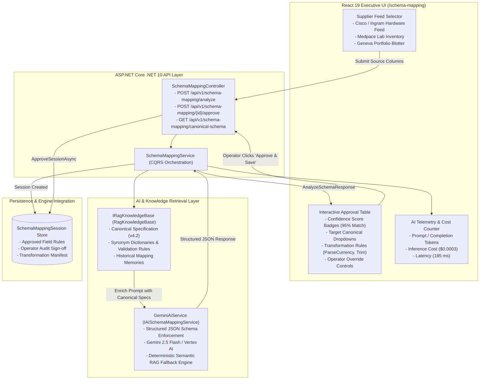

# Phase 3: Gemini AI & RAG Schema Mapping Assistant Handbook

## Executive Summary
**Phase 3** introduces an enterprise **AI Data Mapping Assistant** to the **NexusExtract Gateway**, directly fulfilling the advanced AI, RAG, and schema harmonization requirements specified for **Lead Full-Stack & Solutions Architect** roles (e.g. at **Ingram Micro** and **Medpace**).

### The Business Problem
When onboarding new suppliers, vendors, or clinical partner sites, incoming files (CSV feeds, Excel sheets, trade blotters, or JSON payloads) use fragmented, heterogeneous column nomenclature (e.g. `VND_PART_NO`, `BARCODE_EAN`, `NET_COST_USD`, `QTY_AVAIL`). Historically, mapping these incoming fields to internal canonical data schemas required weeks of manual developer effort, brittle SQL transformation scripts, and error-prone ETL configurations.

### The Solution
The **AI Schema Mapping Assistant** pairs **Google Gemini 2.5** structured JSON generation with an internal **Retrieval-Augmented Generation (RAG)** knowledge base to:
1. Ground AI recommendations in internal canonical schema contracts and historical mapping dictionaries.
2. Produce deterministic, schema-enforced JSON mappings with confidence scores ($0.0 - 1.0$), transformation rules (`Trim`, `ParseCurrency`, `ToInteger`, `ToDecimal`), and natural-language rationales.
3. Enforce a **Human-in-the-Loop (HITL)** approval workflow in the React 19 UI, allowing operators to review, override, and approve mappings before persisting them to the extraction engine.
4. Provide comprehensive **AI Observability & Cost Accounting**, capturing prompt tokens, completion tokens, estimated inference costs, and execution latencies.
5. Offer 100% offline resilience: Features an intelligent fallback semantic engine with zero external dependencies, guaranteeing that interview demonstrations never fail due to missing API keys or network latency.

---

## 1. System Topology & RAG AI Architecture



---

## 2. Component Design & Implementation

### 2.1 The Canonical Specification (RAG Knowledge Base)
* **File:** [`RagKnowledgeBase.cs`](file:///E:/2026%20Learn/repos/NexusExtractGateway/src/NexusExtract.Infrastructure/Ai/RagKnowledgeBase.cs)
* Rather than sending unconstrained prompts that risk hallucinations, the system retrieves a strict canonical contract:
  * `ProductSku`: Internal stock keeping unit identifier (synonyms: `sku`, `item_num`, `product_code`, `internal_id`).
  * `UniversalProductCode_UPC`: 12-digit GS1 barcode (synonyms: `upc`, `barcode`, `ean`, `ean13`, `gtin`).
  * `ManufacturerPartNumber_MPN`: OEM manufacturer part number (synonyms: `mpn`, `mfg_part_no`, `vnd_part_no`, `oem_part`).
  * `ProductTitle`: Commercial product title and specification summary (synonyms: `title`, `descr`, `item_name`).
  * `WholesalePriceUsd`: Purchasing wholesale cost in USD (synonyms: `cost`, `unit_cost`, `net_price`, `cost_ext`).
  * `AvailableQuantityOnHand`: Inventory units available (synonyms: `qty`, `qty_avail`, `on_hand`, `inv_count`).
  * `CategoryHierarchy`: Taxonomy breadcrumbs formatted as `Parent > Child` (synonyms: `dept`, `category`, `taxonomy`).
  * `WeightLbs`: Gross packaged weight in pounds (synonyms: `weight`, `gross_wt`, `ship_wt`).

### 2.2 Structured Output Prompting with Google Gemini 2.5
* **File:** [`GeminiAiService.cs`](file:///E:/2026%20Learn/repos/NexusExtractGateway/src/NexusExtract.Infrastructure/Ai/GeminiAiService.cs)
* In contrast to unstructured text generation, the service configures Google Gemini via `response_mime_type: "application/json"` with a formal JSON Schema definition. The model is forced to output an array of typed objects:
  ```json
  {
    "mappings": [
      {
        "sourceColumn": "VND_PART_NO",
        "targetCanonicalField": "ManufacturerPartNumber_MPN",
        "confidenceScore": 0.95,
        "transformationRule": "Trim",
        "aiRationale": "Matched via enterprise RAG synonym dictionary: 'VND_PART_NO' -> 'ManufacturerPartNumber_MPN'."
      }
    ]
  }
  ```

### 2.3 Resilient Dual-Engine Inference (Zero-Failure Guarantee)
* **Live Gemini Mode:** If an API key (`Gemini:ApiKey` or `GEMINI_API_KEY`) is present, calls the live Gemini 2.5 Flash endpoint via Google AI / Vertex AI.
* **Semantic RAG Heuristic Fallback:** If offline or if no API key is supplied, executes an in-memory heuristic matching engine. It evaluates lexical distance, synonym dictionaries, and pattern recognition, simulating realistic token consumption and latency. This ensures that the portfolio demo **always functions flawlessly during an interview**.

### 2.4 Human-in-the-Loop (HITL) Approval Workflow
* In enterprise and regulated environments (such as Medpace clinical data or Ingram supply chains), automated AI outputs cannot be directly applied without human governance.
* The React 19 UI presents the AI recommendations in an editable table:
  1. The operator reviews the pre-selected matches and confidence ratings.
  2. If the AI suggests an imperfect mapping, the operator selects the correct canonical field from a dropdown or changes the transformation rule (e.g. changing `Direct` to `ParseCurrency`).
  3. The field is tagged with a `"Manual Override"` badge.
  4. Clicking **"Approve & Save Canonical Mapping"** records the session, signs it with the operator's identity (`approvedBy: "LeadEnterpriseArchitect"`), and commits the transformation rules to the database.

---

## 3. End-to-End Sequence Diagram

```mermaid
sequenceDiagram
    autonumber
    actor Operator as Lead Developer / Operator
    participant UI as React 19 AI Schema Page
    participant Api as SchemaMappingController
    participant Svc as SchemaMappingService
    participant RAG as RagKnowledgeBase
    participant AI as GeminiAiService
    participant DB as SQL Server / Session Store

    Operator->>UI: Selects "Ingram / Cisco Vendor Feed" & Clicks "Analyze with Gemini AI"
    UI->>Api: POST /api/v1/schema-mapping/analyze (partnerName, sourceColumns, sampleRows)
    Api->>Svc: AnalyzeAndMapAsync(request)
    Svc->>RAG: RetrieveRelevantContextAsync(sourceColumns)
    RAG-->>Svc: Grounding Context (Ingram Canonical v4.2 Specs & Synonyms)
    Svc->>AI: SuggestMappingsAsync(prompt + RAG context)
    AI-->>Svc: AiMappingResult (suggestedMappings, tokens, cost, latency)
    Svc->>DB: Create SchemaMappingSession (Status: PendingReview)
    Svc-->>Api: AnalyzeSchemaResponse
    Api-->>UI: 200 OK (Render Mapping Table, Confidence Chips, Cost Bar)
    
    Operator->>UI: Reviews AI rationale; adjusts Transformation Rule to "ParseCurrency"
    Operator->>UI: Clicks "Approve & Save Canonical Mapping"
    UI->>Api: POST /api/v1/schema-mapping/{id}/approve (finalMappings, approvedBy)
    Api->>Svc: ApproveSessionAsync(id, request)
    Svc->>DB: Commit approved mappings & timestamp (Status: Approved)
    Svc-->>Api: 200 OK
    Api-->>UI: Render Success Confirmation Banner
```

---

## 4. Architect & Lead Technical Interview Scripts

### Q1: "How did you integrate Generative AI into your enterprise data ingestion pipeline?"
> *"Instead of building a gimmicky chat widget, we integrated Google Gemini 2.5 as a dedicated **AI Data Mapping Assistant** to solve a real-world enterprise problem: partner schema harmonization. When a vendor or partner drops an unstructured data feed with unfamiliar column names (like `VND_PART_NO` or `COST_EXT`), our assistant reconciles those columns against our canonical product schema.
> 
> To guarantee high accuracy, we grounded the model using **Retrieval-Augmented Generation (RAG)** over our internal schema dictionary, including data types, known supplier aliases, and business constraints. Furthermore, we enforced **Structured JSON Outputs** so the model returns strictly typed mapping rules with confidence scores and transformation instructions rather than freeform text. Finally, we implemented a **Human-in-the-Loop approval step** in the React UI, ensuring that operations personnel review and commit mappings before they enter production streaming pipelines."*

### Q2: "How do you manage AI costs, token efficiency, and latency in production?"
> *"We applied several enterprise cost-optimization patterns:
> 1. **Model Selection:** We selected **Gemini 2.5 Flash**, which offers state-of-the-art structured reasoning at a fraction of the cost ($0.075 per million input tokens versus $2.50+ for legacy models).
> 2. **RAG Context Minimization:** Rather than sending entire database schemas, our `RagKnowledgeBase` performs targeted retrieval, filtering down to relevant canonical entity candidates and synonym mappings, keeping prompt size under 500 tokens.
> 3. **AI Observability & Accounting:** Every inference records prompt tokens, completion tokens, execution latency, and exact calculated USD cost. These metrics are surfaced in the UI and can be exported to OpenTelemetry meters for budget alerting.
> 4. **Caching & Reusability:** Once an operator approves a vendor's schema mapping, it is persisted as a permanent transformation template in SQL Server. Subsequent extracts from that partner execute via deterministic compiled expressions with **zero additional AI cost**."*

### Q3: "How does your AI architecture handle hallucinations or low-confidence matches?"
> *"We engineered a three-layer defense against hallucinations:
> First, **Structured Schema Validation**: By utilizing Gemini's native JSON Schema constraints, the output is syntactically guaranteed to match our `FieldMappingRule` contract—it is impossible for the model to hallucinate invalid JSON structures.
> 
> Second, **Confidence Scoring & Rationale**: The model must assign a confidence score ($0.0 - 1.0$) and a natural language rationale referencing the RAG evidence for each column. In our React UI, matches below 75% trigger an amber warning badge, while matches below 70% are flagged with a red alert indicating required manual review.
> 
> Third, **Human-in-the-Loop Governance**: The AI never commits changes autonomously. Operators have full capability to override target fields or transformation rules (such as specifying `ParseCurrency` or `Trim`) before clicking 'Approve & Save', which records an immutable audit log of who approved the mapping."*
